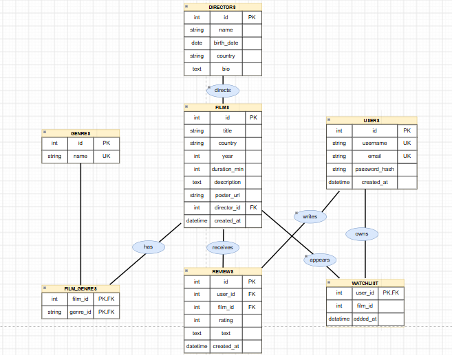

# MovieGuide

## Опис проєкту
**MovieGuide** — це сучасна інтерактивна вебплатформа для любителів кіно. 

**Головна ідея сайту:** надати користувачам зручний каталог фільмів із можливістю пошуку та фільтрації за жанрами, режисерами, країнами,
рейтингом та датою виходу, перегляду детальної інформації 
про фільми та режисерів, ведення списку улюблених стрічок та отримання персоналізованих рекомендацій. 
Також передбачена можливість реєстрації, створення відгуку та оцінки фільмів.

---

## Архітектура REST API

Усі запити та відповіді передаються у форматі `JSON`. Базовий префікс для всіх ендпоінтів: `/api`.

### 1. Фільми (`/api/movies`)

* **`GET /api/movies`** — Отримати список усіх фільмів (каталог).
  * *Query параметри:* `search` (пошук за назвою), `genre_id`, `director_id`, `sort_by` (`rating`, `year`, `duration_min`, `country`).
  * *Response Status:* `200 OK`
  * *Response Body:* Масив об'єктів фільмів.

* **`GET /api/movies/{id}`** — Отримати детальну інформацію про конкретний фільм.
  * *Response Status:* `200 OK` (або `404 Not Found`)
  * *Response Body:* Об'єкт фільму з описами, жанрами, режисером та рейтингом.

* **`POST /api/movies`** — Додати новий фільм.
  * *Request Body:*
    ```json
    {
      "title": "Summer",
      "director_id": 10,
      "genre_ids": [2, 7]
    }
    ```
  * *Response Status:* `201 Created`

* **`PUT /api/movies/{id}`** — Оновити інформацію про фільм.
  * *Request Body:* Поля для оновлення.
  * *Response Status:* `200 OK`

* **`DELETE /api/movies/{id}`** — Видалити фільм.
  * *Response Status:* `204 No Content`

* **`GET /api/movies/popular`** — Переглянути популярні фільми.
  * *Response Status:* `200 OK`
---

### 2. Режисери (`/api/directors`)

* **`GET /api/directors`** — Отримати список усіх режисерів.
  * *Response Status:* `200 OK`

* **`GET /api/directors/{id}`** — Отримати профіль режисера разом зі списком його фільмів.
  * *Response Status:* `200 OK`

* **`POST /api/directors`** — Додати нового режисера.
  * *Request Body:*
    ```json
    {
      "name": "blablabla",
      "bio": "..",
      "birth_date": "1970-07-30"
    }
    ```
  * *Response Status:* `201 Created`

* **`PUT /api/directors/{id}`** — Редагувати дані режисера.
  * *Response Status:* `200 OK`

* **`DELETE /api/directors/{id}`** — Видалити режисера.
  * *Response Status:* `204 No Content`


---

### 3. Жанри (`/api/genres`)

* **`GET /api/genres`** — Отримати список усіх жанрів.
  * *Response Status:* `200 OK`

* **`POST /api/genres`** — Створити новий жанр.
  * *Request Body:*
    ```json
    {
      "name": "Фантастика"
    }
    ```
  * *Response Status:* `201 Created`

* **`DELETE /api/genres/{id}`** — Видалити жанр.
  * *Response Status:* `204 No Content`

* **`GET /api/genres/{id}/movies`** — Отримати список фільмів певного жанру.
  * *Response Status:* `200 OK`
---

### 4. Користувачі та Авторизація (`/api/auth`, `/api/users`)

* **`POST /api/auth/register`** — Реєстрація нового користувача.
  * *Request Body:*
    ```json
    {
      "email": "user@example.com",
      "password": "securepassword",
      "username": "movie_fan"
    }
    ```
  * *Response Status:* `201 Created`

* **`POST /api/auth/login`** — Авторизація користувача.
  * *Request Body:*
    ```json
    {
      "email": "user@example.com",
      "password": "securepassword"
    }
    ```
  * *Response Status:* `200 OK` (повертає токен доступу)

* **`GET /api/users/profile`** — Отримати профіль поточного авторизованого користувача.
  * *Response Status:* `200 OK`

* **`PUT /api/users/profile`** — Оновити дані свого профілю.
  * *Response Status:* `200 OK`

---

### 5. Улюблене(Watchlist) (`/api/watchlist`)

* **`GET /api/watchlist`** — Отримати список улюблених фільмів користувача.
  * *Response Status:* `200 OK`

* **`POST /api/watchlist`** — Додати фільм до обраного.
  * *Request Body:*
    ```json
    {
      "movie_id": 1
    }
    ```
  * *Response Status:* `201 Created`

* **`DELETE /api/watchlist/{movie_id}`** — Видалити фільм з обраного.
  * *Response Status:* `204 No Content`
  
---

### 6. Рекомендації (`/api/recommendations`)
* **`GET /api/recommendations`** — Отримати персоналізовані рекомендації фільмів на основі вподобань користувача.
  * *Response Status:* `200 OK`

---

### 7. Відгуки та оцінки (`/api/reviews`)

* **`GET /api/movies]{movie_id}/reviews`** — Отримати усі відгуки еа фільм.
  * *Response Status:* `200 OK`

* **`POST /api/reviews`** — Створити новий відгук.
  * *Request Body:*
    ```json
    {
      "movie_id": 1,
      "rating": 9
    }
    ```
  * *Response Status:* `201 Created`

* **`DELETE /api/reviews/{id}`** — Видалити жанр відгук.
  * *Response Status:* `204 No Content`

* **`PUT /api/reviews/{id}`** — Редагувати відгук.
  * *Response Status:* `200 OK`
---

### Схема бази даних
